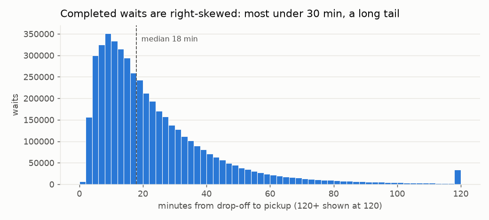
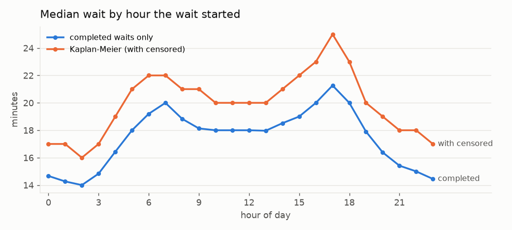
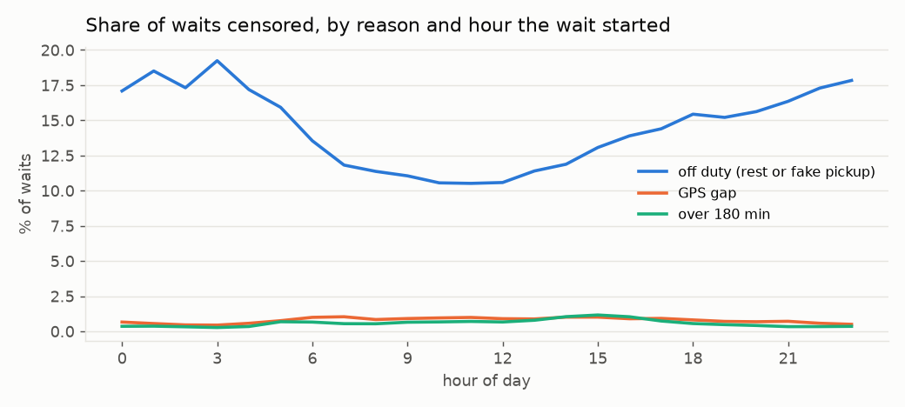
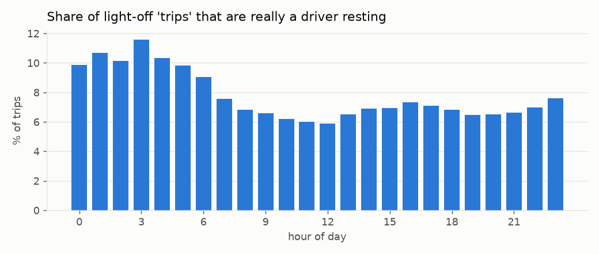
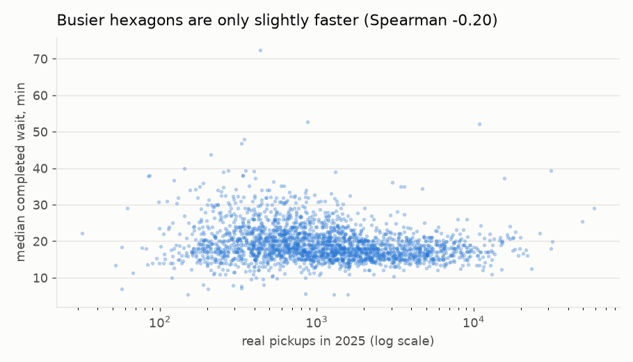
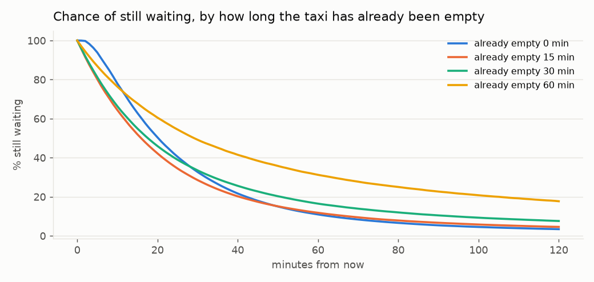
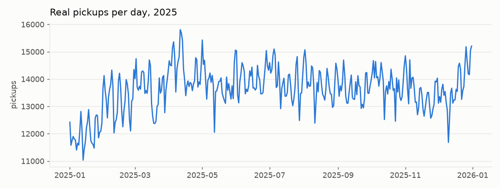

# EDA update with the cleaned data (rules v1.0)

Recomputed after the data audit. Differences from the first EDA come from removing fake trips, cutting rests out of waits, censoring very long waits and leaving out probable missed trips. 29 August 2025 (low coverage) is excluded. Waits flagged as possible missed trips are left out.

## 1. How long waits last

| Measure | First EDA | Rules v1.0 |
| --- | --- | --- |
| Waits analysed | 5,651,362 | 5,524,874 |
| Censored | 2.0% | 15.3% |
| Completed wait, 25% / median / 75% / 90% | 10 / 18 / 32 / 54 min | 10 / 18 / 31 / 48 min |
| Median counting censored waits (Kaplan-Meier) | not computed | 20 min |

The median of completed waits alone is a little optimistic: censored waits (mostly cut by a rest) are known to be at least as long as observed, and Kaplan-Meier uses them.

## 2. Waits and censoring by hour

Completed waits are shortest around 02:00 (14 min) and longest around 17:00 (21 min). Off-duty censoring peaks at 03:00 (19% of waits starting then), when many drivers stop for a break or end their shift.

## 3. Fake trips

7.3% of light-off periods are drivers resting with the light switched to occupied, from 6% at 12:00 to 12% at 03:00. Counting them as pickups would have inflated night-time demand.

## 4. Is the busiest area also the fastest?

Across 2,295 hexagons with at least 100 completed waits, the rank correlation between yearly real pickups and median wait is -0.20 (first EDA: -0.22 over 2,768 hexagons). Demand alone still explains little of the wait, which supports predicting waits directly.

## 5. Survival curves: the wait ahead depends on the wait so far

Kaplan-Meier on Model B snapshots (every 7th day), censored snapshots included:

| Already empty | Snapshots | Median further wait | Chance of a pickup within 15 min |
| --- | --- | --- | --- |
| 0 min | 795,538 | 21 min | 37% |
| 5 min | 728,614 | 17 min | 46% |
| 15 min | 458,175 | 16 min | 48% |
| 30 min | 218,219 | 18 min | 45% |
| 45 min | 109,211 | 23 min | 39% |
| 60 min | 60,365 | 30 min | 32% |
| 90 min | 24,150 | 52 min | 22% |

This is the historical survival baseline in its simplest form (one curve per minutes-empty value, no area or hour). Model B must beat curves like these.

## 6. Across the year

Median 13,675 real pickups a day (range 11,033 to 15,806).

