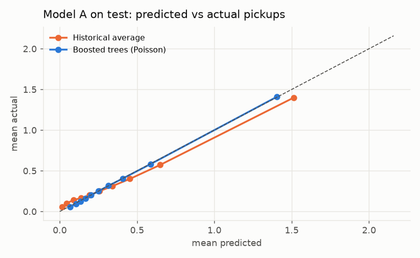
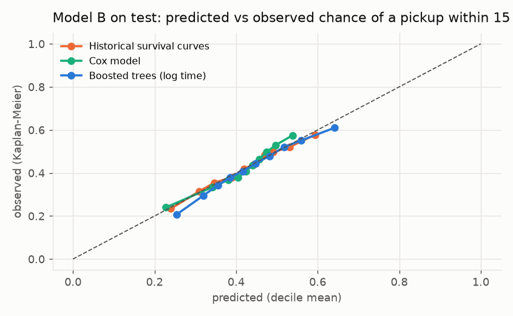

# Test-period results (one-time run)

Run on 2026-11-14 20:40. Test period 20251110 to 20251231; models trained on 20250129 to 20250915 and frozen on validation (20250916 to 20251109). Nothing was retrained or retuned for this run. Frozen choices: Model A = Boosted trees (Poisson), Model B = Boosted trees (log time).

## E1, Model A: pickups per hexagon-hour

925,489 test hexagon-hours, mean 0.360 pickups. Poisson deviance decides; lower is better.

| Model | Deviance, validation | Deviance, test | MAE, test | RMSE, test | Mean predicted, test |
| --- | --- | --- | --- | --- | --- |
| Historical average | 0.782 | 0.776 | 0.403 | 0.627 | 0.369 |
| Poisson regression | 0.791 | 0.781 | 0.428 | 0.639 | 0.373 |
| Boosted trees (Poisson) (frozen) | 0.757 | 0.748 | 0.412 | 0.621 | 0.364 |

Frozen Model A vs historical average on test: deviance 3.6% lower (beats the baseline).

Poisson deviance by group (test):

| Group | Rows | Historical average | Poisson regression | Boosted trees (Poisson) |
| --- | --- | --- | --- | --- |
| all | 925,489 | 0.776 | 0.781 | 0.748 |
| quiet hours (01:00-05:00) | 120,585 | 0.688 | 0.696 | 0.667 |
| rush hours (07-09, 16-19) | 323,237 | 0.794 | 0.799 | 0.765 |
| weekday | 674,564 | 0.774 | 0.780 | 0.746 |
| weekend | 250,925 | 0.780 | 0.783 | 0.752 |
| public holiday | 53,656 | 0.803 | 0.795 | 0.761 |
| central (<= 8 km) | 129,450 | 1.093 | 1.122 | 1.080 |
| outer (> 8 km) | 796,039 | 0.724 | 0.725 | 0.694 |

## E1, Model B: minutes until the next pickup (censored)

866,709 test snapshots, 80.2% with a pickup seen. C-index decides (higher is better, 0.5 = coin flip); it is computed on a 20,000-row subsample, and the range over 5 different subsamples shows how much that choice moves it. Brier score and calibration error: lower is better.

| Model | C-index, validation | C-index, test | Test range over 5 subsamples | Brier at 15 min, test | Calibration error at 15 min, test | MAE completed (min), test | Mean predicted P(15) | Observed P(15) |
| --- | --- | --- | --- | --- | --- | --- | --- | --- |
| Historical survival curves | 0.574 | 0.578 | 0.573 to 0.579 | 0.233 | 0.008 | 15.3 | 0.424 | 0.422 |
| Cox model | 0.588 | 0.588 | 0.582 to 0.589 | 0.235 | 0.018 | 15.5 | 0.418 | 0.422 |
| Boosted trees (log time) (frozen) | 0.604 | 0.603 | 0.597 to 0.603 | 0.229 | 0.015 | 14.5 | 0.438 | 0.422 |

Frozen Model B vs historical survival curves on test: C-index 0.603 vs 0.578 (beats the baseline on every subsample).

## E3 on test: C-index by group

Same groups as the validation report, plus weekday, weekend and public holidays (E5). Groups with fewer than 200 snapshots are left out.

| Group | Snapshots | Censored | Historical survival curves | Cox model | Boosted trees (log time) |
| --- | --- | --- | --- | --- | --- |
| all | 866,709 | 20% | 0.578 | 0.588 | 0.603 |
| quiet hours (01:00-05:00) | 69,244 | 22% | 0.560 | 0.579 | 0.601 |
| rush hours (07-09, 16-19) | 337,792 | 20% | 0.571 | 0.581 | 0.595 |
| weekday | 639,494 | 20% | 0.580 | 0.590 | 0.601 |
| weekend | 227,215 | 19% | 0.571 | 0.584 | 0.599 |
| public holiday | 44,232 | 19% | 0.564 | 0.573 | 0.591 |
| central (<= 8 km) | 319,530 | 17% | 0.593 | 0.600 | 0.598 |
| outer (> 8 km) | 547,179 | 22% | 0.561 | 0.576 | 0.596 |
| empty under 15 min | 417,270 | 15% | 0.566 | 0.581 | 0.600 |
| empty 30 min or more | 232,956 | 31% | 0.577 | 0.591 | 0.594 |

