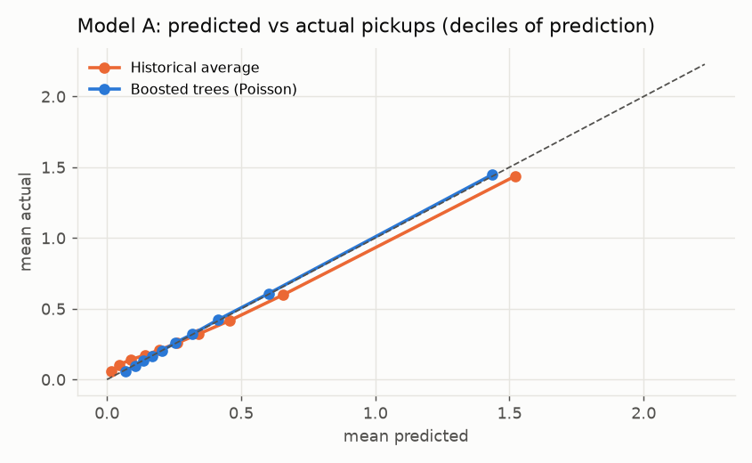
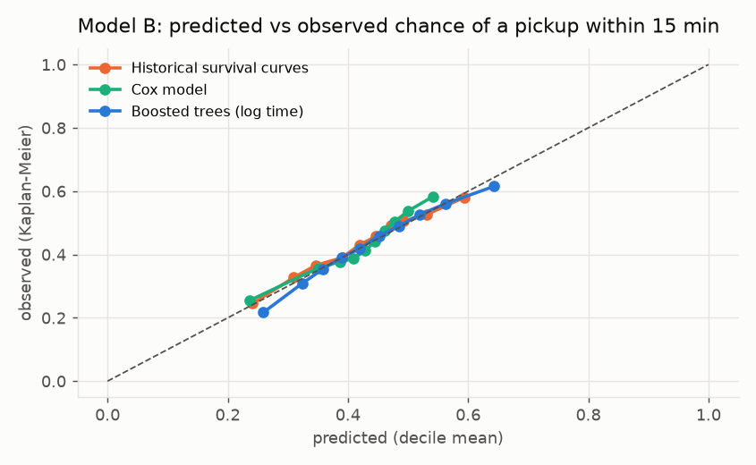
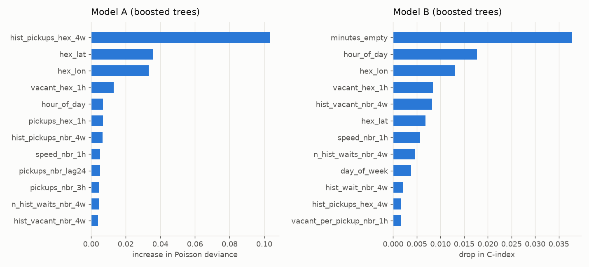

# Model validation report

Validation period 20250916 to 20251109; models trained on 20250129 to 20250915 (29 August excluded). The test period is untouched.

## Model A: pickups per hexagon-hour

967,580 validation hexagon-hours (mean 0.371 pickups, 26% non-zero). Lower is better for every column except the mean, which should match the actual mean (0.371).

| Model | Poisson deviance | MAE | RMSE | MAE, zero hours | MAE, non-zero hours | Mean predicted |
| --- | --- | --- | --- | --- | --- | --- |
| Historical average | 0.782 | 0.408 | 0.631 | 0.255 | 0.842 | 0.372 |
| Poisson regression | 0.791 | 0.433 | 0.648 | 0.276 | 0.881 | 0.377 |
| Boosted trees (Poisson) | 0.757 | 0.418 | 0.629 | 0.265 | 0.856 | 0.371 |

**Frozen Model A: Boosted trees (Poisson)** (lowest validation Poisson deviance; 3.1% lower than the historical average).

Poisson deviance by area:

| Area | Rows | Historical average | Poisson regression | Boosted trees (Poisson) |
| --- | --- | --- | --- | --- |
| central | 136,421 | 1.090 | 1.129 | 1.085 |
| outer | 831,159 | 0.731 | 0.735 | 0.704 |

## Model B: minutes until the next pickup (censored)

915,178 validation snapshots, 81.7% with a pickup seen. C-index: higher is better (0.5 = coin flip). Brier score and calibration error: lower is better. The observed chance of a pickup within 15 minutes is the Kaplan-Meier value for all validation snapshots.

| Model | C-index | Brier at 15 min | Calibration error at 15 min | MAE, completed waits (min) | Mean predicted P(pickup in 15 min) | Observed |
| --- | --- | --- | --- | --- | --- | --- |
| Historical survival curves | 0.574 | 0.235 | 0.012 | 15.2 | 0.425 | 0.433 |
| Cox model | 0.588 | 0.237 | 0.020 | 15.3 | 0.424 | 0.433 |
| Boosted trees (log time) | 0.604 | 0.230 | 0.011 | 14.4 | 0.441 | 0.433 |

**Frozen Model B: Boosted trees (log time)** (highest validation C-index; it gives a full survival curve, so the app can compute the 60-minute score from it). The historical survival curves stay as the fallback for areas with too little data.

## E3: is the result robust across groups and censoring?

C-index by group (higher is better). Censoring is higher at night and in outer areas, where handling censored waits matters most.

| Group | Snapshots | Censored | Historical survival curves | Cox model | Boosted trees (log time) |
| --- | --- | --- | --- | --- | --- |
| all | 915,178 | 18% | 0.574 | 0.588 | 0.604 |
| quiet hours (01:00-05:00) | 72,659 | 21% | 0.556 | 0.576 | 0.597 |
| rush hours (07-09, 16-19) | 362,099 | 18% | 0.562 | 0.575 | 0.597 |
| central (<= 8 km) | 337,561 | 16% | 0.590 | 0.600 | 0.604 |
| outer (> 8 km) | 577,617 | 20% | 0.556 | 0.575 | 0.594 |
| empty under 15 min | 446,539 | 14% | 0.562 | 0.578 | 0.600 |
| empty 30 min or more | 239,291 | 29% | 0.576 | 0.593 | 0.595 |

## E4: which feature groups add value?

Boosted trees with the tuned settings, trained on 400,000 training rows, adding one group at a time (calendar and place first). Model B always also has minutes empty.

| Added group | Features | Model A deviance | Model B C-index |
| --- | --- | --- | --- |
| calendar place | 7 | 0.767 | 0.600 |
| recent demand | 12 | 0.778 | 0.600 |
| competition | 16 | 0.779 | 0.601 |
| traffic | 17 | 0.781 | 0.602 |
| recent waits | 19 | 0.783 | 0.601 |
| history | 24 | 0.773 | 0.603 |
| weather | 25 | 0.772 | 0.602 |

## Feature importance

Permutation importance on validation rows: how much worse the model gets when one feature is shuffled. These are associations the model uses, not causes.

## Tuning

Random search with the same budget for each learned model, scored on two forward-chaining folds inside the training period.

| Model | Metric | Trials | Best fold mean | Best setting |
| --- | --- | --- | --- | --- |
| Poisson regression | poisson_deviance (lower is better) | 10 | 0.7879 | 0.001 |
| Boosted trees (Poisson) | poisson_deviance (lower is better) | 10 | 0.7659 | {'learning_rate': 0.05, 'max_leaf_nodes': 127, 'min_samples_leaf': 50, 'l2_regularization': 1.0, 'max_features': 0.5} |
| Cox model | c_index (higher is better) | 10 | 0.5838 | 0.004641588833612782 |
| Boosted trees (log time) | c_index (higher is better) | 10 | 0.5969 | {'learning_rate': 0.03, 'max_leaf_nodes': 63, 'min_samples_leaf': 500, 'l2_regularization': 10.0, 'max_features': 1.0} |

